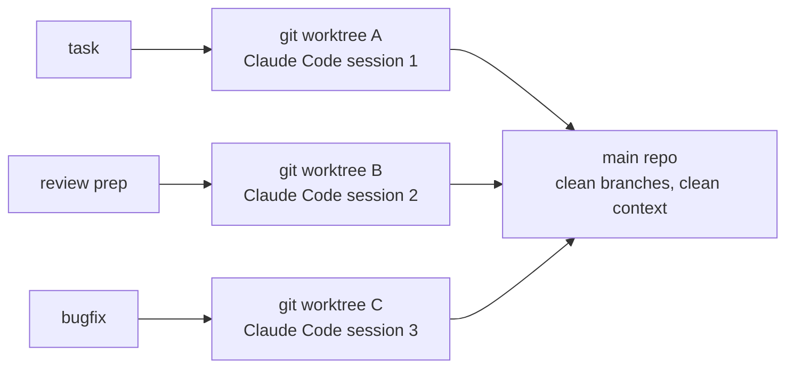

# Claude Code worktree tooling — how I actually work

**What:** my own tooling around Claude Code to run several coding agents in parallel, one per git worktree
**Status:** personal tooling, used every working day
**Code:** private for now

## The problem

One Claude Code session works on one thing. My day rarely does: a feature in progress, a review to prepare, a bug on a release branch. Switching one session between them loses context every time.

## What the tooling does

- **One worktree per task, one agent per worktree** — parallel sessions that never trample each other's files or context.
- **Context loading per task** — each session starts with the right project context for its branch instead of a cold start.
- **Review preparation** — before I review a PR, an agent drafts the walkthrough: what changed, where the risk is. I still do the review; I just don't start from a blank page.

## Why it matters

AI-assisted development is my normal daily workflow, not an experiment I read about. I have been working this way long enough to know where agents are strong (mechanical changes, test scaffolding, first-pass reviews) and where they are not (design judgment, domain rules) — and I built my workflow around that line.
