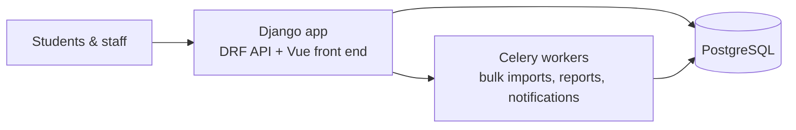

# College management platform — 2,000+ students, built solo

**Client:** Al-Hadi University College (Baghdad)
**Scale:** 2,000+ students, plus lecturers and administration staff
**Role:** built the platform solo; later led the college's 3-engineer software unit (backend, frontend, mobile)
**Code:** private (institution system)

## What it is

The college's core administration platform: student records, course and enrollment management, grades and the day-to-day workflows between registration, lecturers and administration.

## Stack

Django · Django REST Framework · PostgreSQL · Celery + Redis · Vue.js

## Architecture

## Problems worth mentioning

- **Academic rules as code.** Enrollment prerequisites, grading schemes and pass/fail rules differ per department and per academic year — versioned rules instead of hard-coded constants.
- **Semester-peak load.** Registration windows concentrate a semester's traffic into days. Bulk operations (imports, grade postings) run through Celery so the interactive app stays responsive.
- **From solo builder to team lead.** V1 was mine end to end. As the unit grew to three engineers, I set the review process and split ownership — my first experience turning "my system" into "our system".

## What it taught me

An institution adopts software only when it trusts the data. Half the work was making records provably correct — audit trails, validation on import, and reports the administration could check against their own books.
