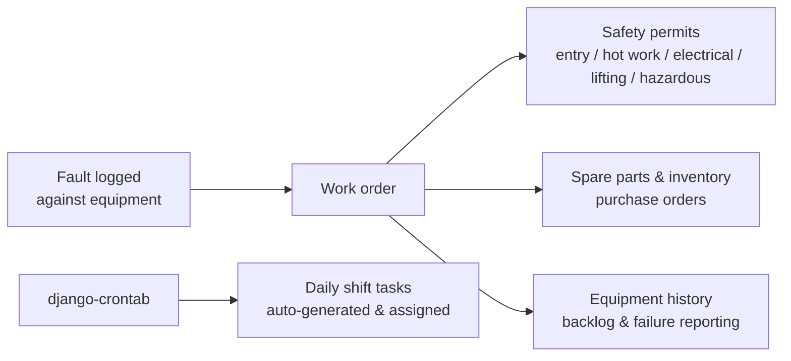

# KMS (Keppt Management System) — maintenance platform for two power plants, built and run solo

**Users:** 400+ plant employees across two power plants
**Status:** built and maintained solo since 2023, live in daily plant operations
**Code:** private (industrial client system)

## What it is

Running live at 2 power plants, replacing paper with a single digital system that handles the **four core jobs of industrial maintenance**:

1. **Faults → work orders** — logging every fault and turning it into a tracked work order
2. **Safety permits** — managing the 5 permit types a dangerous job needs: entry, hot work, electrical, lifting, hazardous substances
3. **Inventory** — spare parts, stock and purchase orders
4. **Shift tasks** — auto-generating and assigning the daily tasks of each shift

## Stack

Django 4.2 · PostgreSQL · Docker · django-crontab

## Core flow

## Problems worth mentioning

- **Safety permits are workflow, not paperwork.** A work order on live electrical equipment cannot start without the right permits. Modeling the 5 permit types with their approvals means the system enforces what the safety book only describes.
- **Bilingual reality.** Field entries are written in Arabic, engineering data in English. The system stores and searches both instead of forcing one language on its users.
- **Industrial users.** Control-room and field staff are not office users: fewer clicks, obvious states, forms that survive a night shift.
- **Reporting management trusts.** Backlog aging and failure trends are computed from recorded fault and work-order dates — reports reflect what actually happened, not what someone remembers.

## What operating it taught me

Domain modeling is the whole game. Once fault → work order → permits → history matched how the plants actually work, everything else (screens, reports, permissions) followed. Getting that model right meant sitting with maintenance engineers, not just writing code.
