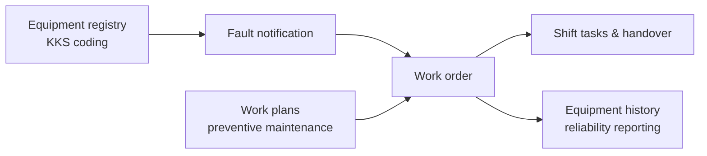

# KMS — maintenance management for two power plants, built solo

**Users:** 400+ engineers, technicians and supervisors across two combined-cycle power plants
**Status:** live in daily plant operations, still operated and extended by me
**Code:** private (industrial client system)

## What it is

A maintenance management system (CMMS) that runs the daily maintenance cycle of two power plants: fault notifications, work orders, work plans and shift tasks — replacing paper logs in an environment where "we lost the record" can mean real downtime.

## Core domain model

- **Fault notifications (FN):** any operator can report a defect against a piece of equipment; numbered per year (`123/2026`), routed to the right section.
- **Work orders (WO):** corrective and routine work, linked to the FN that caused it, with status tracking to closure.
- **Work plans:** recurring preventive maintenance generating work on schedule.
- **Shift tasks:** what each shift must do and hand over.
- **Equipment registry:** plant equipment under KKS-style codes, so history and reliability reporting attach to the right asset.

## Stack

Django · Django REST Framework · PostgreSQL · Celery + Redis · Vue.js · Docker

## Problems worth mentioning

- **Bilingual reality.** Field entries are written in Arabic, engineering data in English. The system stores and searches both instead of forcing one language on its users.
- **Reporting for management.** Backlog aging, failure trends per equipment, section performance — computed from recorded FN/WO dates, so reports reflect what actually happened.
- **Industrial users.** Control-room and field staff are not office users: fewer clicks, obvious states, forms that survive a night shift.

## What operating it taught me

Domain modeling is the whole game. Once fault → work order → history matched how the plants actually work, everything else (permissions, reports, UI) followed. Getting that model right required sitting with maintenance engineers, not just writing code.
