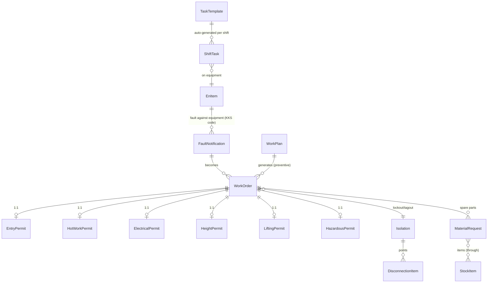
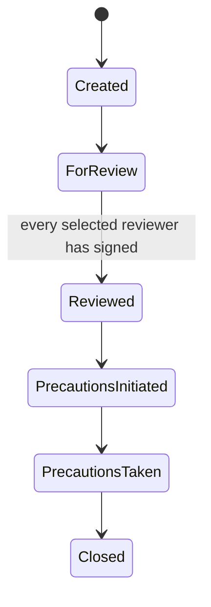

# KMS (Keppt Management System) — plant operations platform, built and run solo

**Users:** 200+ engineers at each of two combined-cycle power plants, each plant on its own instance
**Size:** 11 Django apps · ~90 models · 118 migrations · ~20,000 lines of Python · 900 commits over 2.5 years, one author
**Status:** live in daily plant operations since 2023 · **Code:** private (industrial client system)

It started as "replace the paper maintenance log" and grew into the plant's operations backbone: maintenance, safety permits, inventory, HR, ISO-9001 quality, suppliers, IT assets — one system.

## The modules

| App | What it does |
|---|---|
| `apiceng` | The maintenance engine: KKS equipment registry, fault notifications → work orders, work plans, lockout/tagout isolations, the 6 safety-permit types, shift tasks |
| `apicstore` | Warehouse: stock items with min/max reorder points, material requests, issue/receive with running-balance adjustment |
| `apicusers` | Custom auth + a full HR module: employees, job descriptions, training, evaluations, overtime |
| `apicpermission` | Custom RBAC — a per-group **status-transition permission matrix** (who may move which record to which state) |
| `apicquality` | ISO-9001: versioned documents, records, risk register, KPI definitions and entries |
| `apicsupplier` | Supplier registry with scored evaluations |
| `apicit` | IT assets: devices, assignments, repairs, licenses |
| `apicmoney` | Arabic-first accounting / petty cash |
| + | backups app · cron package · shared soft-delete base · an **MCP server** (below) |

## Domain model (the real one)

## The Permit-To-Work interlock (the heart of it)

Dangerous work is gated by six permit types — entry, hot work, electrical, working at height, lifting, hazardous substances — each a real state machine:

And the work order is interlocked against them:
- A WO can't reach **In progress** until every enabled permit is linked and at **Precautions taken**
- A WO can't be **Completed** until every enabled permit is **Closed**
- **Printing the work packet** is blocked by the same rules — no paper without cleared permits
- A risk-assessment gate forces at least one hazard flag (or an explicit "none applicable") before work starts
- A permit can't reach **Reviewed** until each selected reviewer has individually signed off

One `SpecialPermit` model drives all six forms through a **dynamic JSON field schema** — dozens of per-type checkboxes and fields, one implementation. This is the difference between recording safety paperwork and *enforcing* it.

## Preventive maintenance that survives downtime

django-crontab drives the recurring work:
- **Shift tasks** generate at 06:05 and 18:05 from templates — with **missed-run recovery**: each run looks back 7 days and back-fills anything a downed server skipped before advancing the schedule
- **Routine work orders** generate from work plans in two modes: interval-based (30-day advance horizon, auto-rolling due dates) and event-based (N days after a station event)

## Engineering details I'm proud of

- **Cascade soft-delete with transaction-grouped restore** — a shared base that re-implements Django's `on_delete` matrix (CASCADE / SET_NULL / PROTECT…) for soft deletes, tagging every co-deleted row with a shared transaction id, so `restore()` brings back exactly the set that was deleted together — not siblings deleted last month.
- **RBAC as a status-transition matrix** — per-group JSON matrices per record type (fault, WO, permit, material request…) controlling *which group may move a record into which status*, down to single-field permissions.
- **Deadlock-resilient writes** — a retry-with-backoff wrapper around Postgres lock/deadlock errors for the concurrent shift-change hours.
- **Document generation** — work packets and permits render to Word/PDF (docxtpl + docxcompose): a work plan's uploaded template is copied onto each generated WO and merged with its permit at print time. RTL Arabic PDF via arabic-reshaper + bidi.
- **An MCP server with OAuth2** — a read-only Model Context Protocol layer over the maintenance data (backlog aging, failure trends, equipment MTBF, section performance), so AI assistants can query the plant's state safely. A 2023-style CMMS with a 2026-style AI interface.
- **Biometric attendance** — ZKTeco fingerprint-device integration feeding the HR module.

## Bilingual reality

Field crews write Arabic; engineering data is English. The system stores both side by side (per-model EN/AR export titles, Arabic-first accounting module, RTL document rendering) instead of forcing one language on its users.

## What operating it taught me

Safety logic is where correctness stops being abstract: a bug in the permit interlock is not a ticket, it's a person near live equipment. Building that solo teaches a kind of respect for state machines, constraints and tests that no CRUD app ever will.
