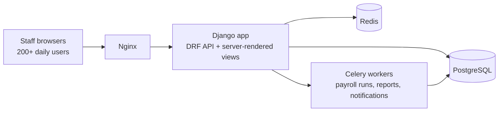

# Two Rivers ERP — university back office, built solo

**Client:** Al-Nahrain University (Baghdad)
**Scale:** used daily by 200+ staff
**Status:** live for years, still operated and extended by me
**Code:** private (client system)

## What it is

A web ERP that runs the university's back office: HR records, payroll, finance and internal document workflows. Before it, these processes ran on paper and spreadsheets across departments.

## Stack

Django · Django REST Framework · PostgreSQL · Celery + Redis · Vue.js · Docker · Nginx

## Architecture

A deliberately boring monolith: one Django project, one PostgreSQL database, Celery for everything slow (payroll calculation runs, report generation, notifications). Boring is what a small operations team can actually keep alive for years.

## Problems worth mentioning

- **Payroll correctness.** Salary rules with allowances and deductions per employee category. Payroll runs are Celery jobs producing an auditable result per employee per month — never computed ad hoc in a request.
- **Permissions that match a real university.** Department heads see their department, HR sees everyone, finance approves but does not edit. Role and object-level checks live at the API layer.
- **Migration from paper.** Historical records were imported in bulk; data-cleaning scripts and validation reports mattered as much as application code.

## What operating it taught me

When you are the only engineer, every architecture decision is a support decision: simple deploys, obvious logs, conservative dependencies. It shaped how I write code at my day job — I optimize for the person who gets paged, because for years that person was me.
