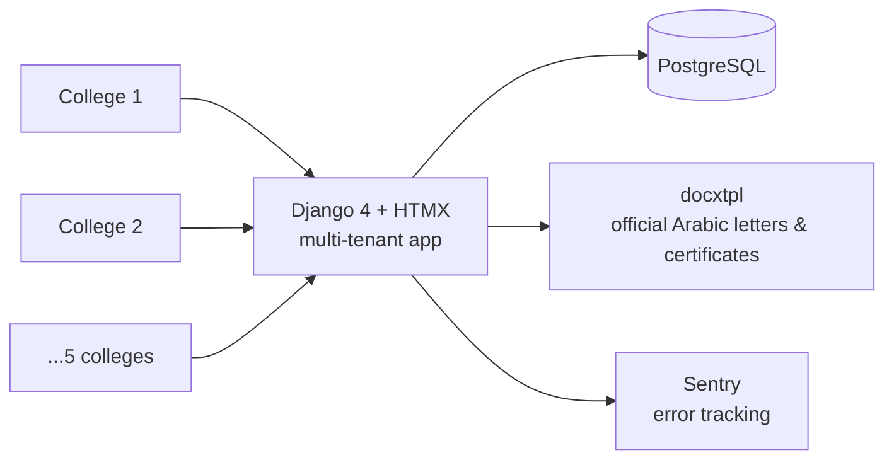

# The Two Rivers — university ERP, built and run solo

**Client:** Al-Nahrain University (Baghdad)
**Scale:** 5 colleges · used daily by 200+ staff
**Status:** built and maintained solo since 2023, still live
**Code:** private (client system)

## What it is

One vision: replace paper and Excel across the university with a single digital system. Two Rivers covers:

- **every student record**, from admission to graduation
- **every employee's payroll and HR data**
- **every financial transaction**
- **every research publication**
- and it **generates every official Arabic letter and certificate** the university issues

## Stack

Django 4 · PostgreSQL · HTMX · docxtpl · Sentry

Server-rendered Django with HTMX for interactivity — no SPA. For a system one engineer runs for years, fewer moving parts is a feature.

## Architecture

Custom **multi-tenant architecture**: each college is a tenant inside one deployment, with a bespoke permission system deciding who sees which college's records.

## Problems worth mentioning

- **Cross-tenant security.** Ran a security hardening pass on my own system and found and fixed **12 cross-tenant data leaks in production**. Hunting your own bugs across tenant boundaries teaches you more about authorization than any framework doc.
- **Official documents as a first-class feature.** Universities live on stamped Arabic letters and certificates. Template-based generation (docxtpl) turned a queue at an office into a button.
- **Everything in one system.** Students, payroll, finance and research publications share one data model — the value is that the registrar, HR and finance stopped reconciling three different sources of truth.

## What operating it taught me

When you are the only engineer, every architecture decision is a support decision: server-rendered pages, one database, obvious logs, conservative dependencies. I optimize for the person who gets paged, because that person is me.
