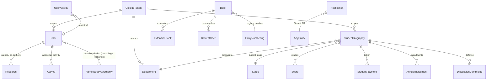
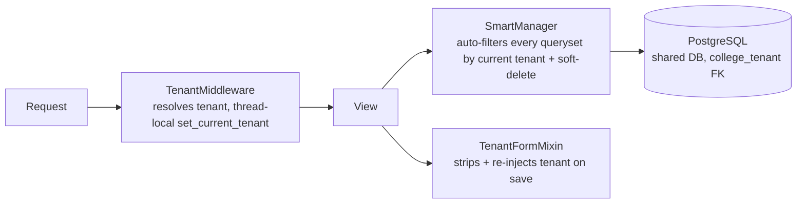

# The Two Rivers — university ERP, built and run solo

**Client:** Al-Nahrain University (Baghdad) · **Scale:** 5 colleges, 200+ staff daily
**Size:** 7 Django apps · 73 models · 385 migrations · ~48,000 lines of Python · 140 templates
**Status:** built and maintained solo since 2023, live · **Code:** private (client system)

Arabic-first (RTL), multi-tenant, server-rendered. One vision: replace paper and Excel across the university with a single system — every student record from admission to graduation, every employee's payroll and HR data, every financial transaction, every research publication, and every official Arabic letter the university issues.

## The modules

| App | What it does |
|---|---|
| `useres` | Custom auth (staff/lecturers), the **college tenant** model, the permission system, ~18 reference registries |
| `Department` | Academic core: students, departments, stages, academic years, course materials, grades, projects, postgraduate admissions |
| `Management` | Research publications, committees & supervision, penalties, graduation records, and the official **correspondence/letters registry** |
| `accounting` | Student finance: tuition, annual installments, discounts, ledgers — plus a payroll sub-module |
| `apicdashboard` | 18 analytics dashboards (college-level and university-level) |
| `notifications` | Notifications attachable to any record via GenericForeignKey |
| `apicBase` | The infrastructure core: `Entity` base model, soft-delete, and the tenancy `SmartManager` |

## Domain model (the real one)

Two details worth noticing:

- **Students are data, not accounts.** `StudentBiography` has no login. `UndergraduateStudent` and `GraduateStudent` are **proxy models** whose managers encode business rules (e.g. graduate students are always morning-shift), so a dashboard can't accidentally mix cohorts.
- **Official letters are a first-class domain.** The `books` registry models the university's real paper bureaucracy — extensions, postponements, return orders, registry numbering — instead of pretending it doesn't exist.

## Multi-tenancy: three cooperating layers

1. **`TenantMiddleware`** resolves the tenant per request into thread-local storage. Regular users are locked to their own college; superusers switch via a **session key** — never a URL parameter.
2. **`SmartManager`** — one manager that detects `college_tenant` and `deleted_date` on any model and default-filters every query. A model opts into tenancy just by declaring the FK. It replaced five hand-written managers. `objects` = tenant-scoped and alive; `all_objects` = admin-only escape hatch.
3. **`TenantFormMixin`** strips the tenant field from every form and re-injects it server-side — users cannot spoof their college through form data.

**Then I attacked my own system:** a cross-tenant security audit found **12 leaks in production** (unfiltered filter-dropdowns, `?college=<id>` URL-parameter leakage in dashboard views). All fixed, documented, and locked in with **30+ regression tests written as attack scenarios**.

## The permission refactor

The original design chained five hops (`given_authority → group_authority → can_edit_group → …`). I replaced it with a direct `UserPermission` — per college, per section, read/write — **keyed by URL name** and enforced by `read_ / write_ / action_permission_required` decorators, with a management command that migrated all existing grants. Authorization you can reason about in one query.

## Arabic-first documents

Official letters and certificates are generated with **docxtpl** from real government-style Word templates — down to details like graduation-confirmation letters **selecting a different template by student gender**, because that is how the official forms actually differ. Aggregated ORM stats (research by authorship position, activities cross-tabbed by type × participation) render straight into the merge fields. Excel out via openpyxl.

## Server-rendered + HTMX

List views (django-tables2 + django-filter) branch on `request.htmx`: full page on first load, **partial table-body swaps** for filter/sort/paginate. ~35 templates use `hx-*`; forms and delete-confirmations render as partials. No SPA, no build step — one person can run this for years.

## Operations

- **Soft-delete everywhere** — `delete()` defaults to soft; `restore()` exists; hard delete is explicit.
- **Custom audit trail** — middleware logs action type, Arabic description, IP (X-Forwarded-For aware), user agent, tenant and JSON extras — and fails silently so auditing can never break a request.
- Sentry for errors; WhiteNoise for static.

## What operating it taught me

Multi-tenant security is not a feature you add — it's three layers that each assume the others will fail. And in a bureaucracy, the paper trail (letters, registry numbers, stamps) *is* the domain: model it honestly and the institution trusts the system; skip it and they keep the paper.
